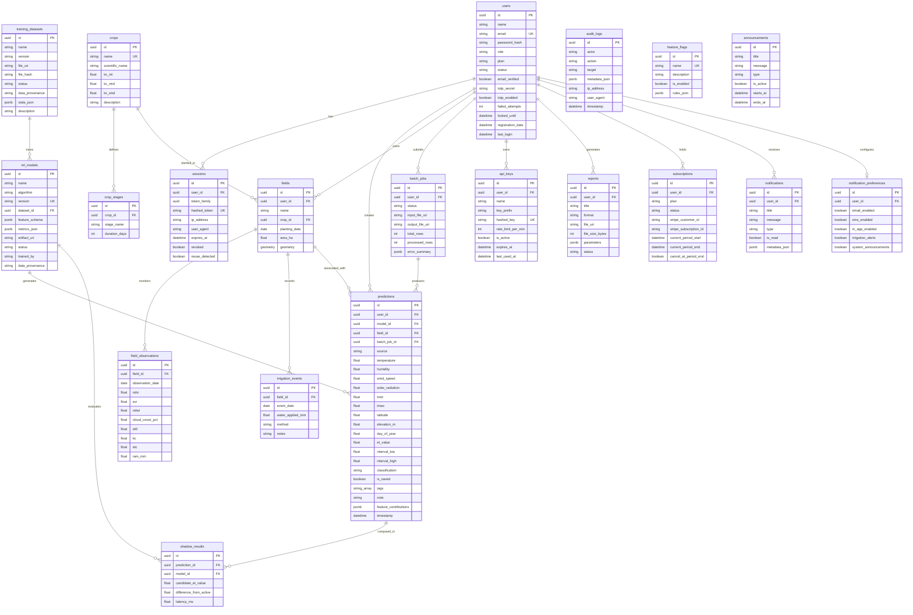

# AgriScope Architecture

This document describes the high-level system architecture, service topology, and data model.

---

## Entity Relationship (ER) Diagram

The diagram below reflects all 20 domain models implemented in `backend/app/models/` and registered with SQLAlchemy 2.0 / Alembic.

